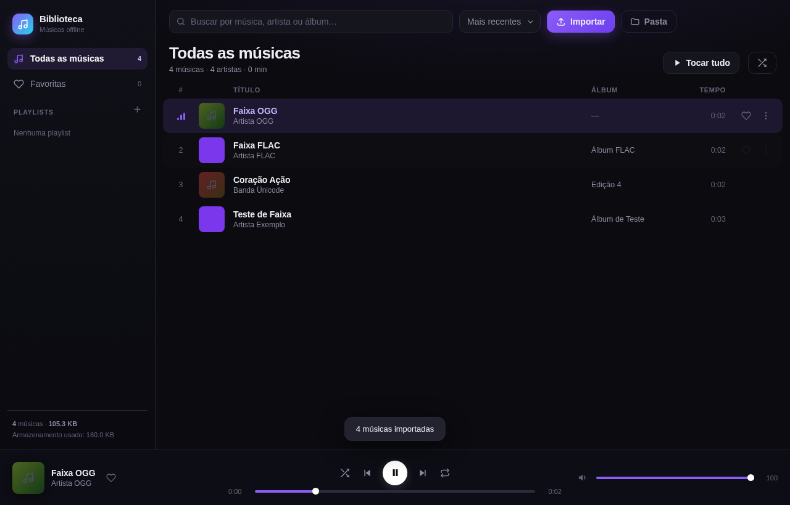

# 🎵 Biblioteca Musical

Player e biblioteca de músicas **offline**, em **um único arquivo HTML** (zero dependências, zero build, zero servidor).

Abra o `index.html` (ou acesse pelo GitHub Pages) e arraste suas músicas para dentro. Tudo fica salvo no seu próprio navegador.



## Funcionalidades

- **Importação** por seletor de arquivos, por pasta inteira ou arrastando e soltando (inclusive pastas).
- **Leitura real de tags**: título, artista, álbum, ano, gênero, número da faixa e **capa embutida**.
  - MP3: ID3v2.2 / v2.3 / v2.4 (incluindo acentuação UTF-8 e UTF-16)
  - FLAC e OGG: Vorbis Comments + bloco de imagem
  - Sem tags? Deduz `Artista - Música` a partir do nome do arquivo.
- **Armazenamento local** via IndexedDB: fecha o navegador e a biblioteca continua lá. Nenhum arquivo sai do seu computador.
- **Player completo**: play/pause, anterior/próxima, barra de progresso, volume, aleatório, repetir tudo / repetir uma.
- **Controles do sistema**: Media Session API (tela de bloqueio e teclas de mídia).
- **Organização**: busca instantânea, ordenação, favoritas e playlists.
- **Responsivo**: barra lateral no desktop, mini-player e menu lateral no celular.
- **Atalhos de teclado**: `espaço` play/pause, `Shift + ←/→` faixa anterior/próxima, `Esc` fecha janelas.

## Como usar

### Opção 1 — direto do arquivo
Baixe o `index.html` e abra com dois cliques.

> Alguns navegadores bloqueiam IndexedDB em páginas `file://`. Se aparecer o aviso de armazenamento, use a opção 2.

### Opção 2 — GitHub Pages (recomendado)
Acesse **https://lcr20023.github.io/biblioteca-musical/** — funciona como um site normal, com o banco de dados disponível.

### Opção 3 — servidor local
```bash
python3 -m http.server 8000
# abra http://localhost:8000
```

## Formatos suportados

`mp3` `m4a` `aac` `ogg` `oga` `opus` `wav` `flac` `webm` `wma` `aiff` `m4b`

A reprodução depende do suporte do navegador ao codec. A leitura de tags é feita internamente, sem bibliotecas.

## Detalhes técnicos

| Item | Escolha |
|---|---|
| Arquitetura | arquivo único (`index.html`), sem dependências |
| Banco | IndexedDB — lojas `tracks` (metadados), `audio` (blobs) e `playlists` |
| Memória | áudio carregado sob demanda via `Blob` + `URL.createObjectURL`, liberado ao trocar de faixa |
| Tags MP3 | parser próprio de ID3v2 (sincsafe, unsynchronisation, UTF-8/UTF-16/latin-1, APIC) |
| Tags FLAC/OGG | parser de metadados FLAC (Vorbis Comment + Picture) e OGG Vorbis |
| Duração | `loadedmetadata` do elemento de áudio, com gravação de volta no registro |
| Layout | CSS Grid puro, sem framework, com breakpoints em 900px e 420px |

## Roadmap

- [ ] Letras (`.lrc`) sincronizadas
- [ ] Equalizador e normalização de volume
- [ ] Edição manual de metadados e capa
- [ ] Exportar/importar biblioteca (backup `.json` + áudio)
- [ ] Fila de reprodução reordenável por arrastar

## Licença

Uso livre, pessoal ou comercial. Só não vendas como se fosse seu. 😄
